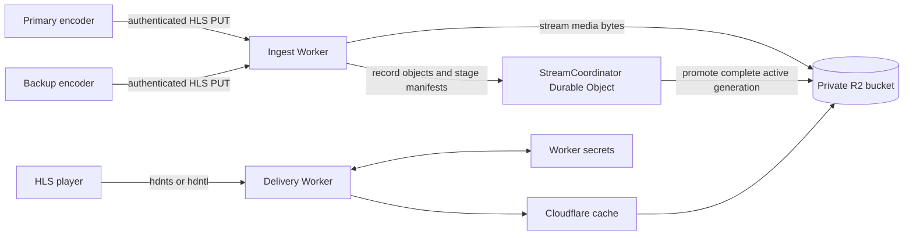

# Protected HLS delivery on Cloudflare

A reference implementation for protected HLS playback and live HLS ingest on Cloudflare Workers. The repository is a technical demonstration, not a production-ready media platform.

[](https://deploy.workers.cloudflare.com/?url=https://github.com/nouvellonsteph/protected-hls)

The application has two walkthroughs:

- **Part 1 - protected delivery:** issues a short-lived `hdnts` access token, exchanges it for a bounded `hdntl` session token, authorizes every media request, and rewrites HLS URIs in memory while canonical objects remain private in R2.
- **Part 2 - live ingest and origin:** accepts authenticated primary and backup HLS `PUT` requests, stores media in isolated R2 prefixes, and uses a SQLite-backed Durable Object to publish only complete manifests and atomically promote either source behind one stable viewer URL.

## Security warning

This repository exposes demonstration control endpoints that can reset live state, stop or start the managed container, delete the live R2 prefix, and issue temporary publisher URLs. The sample `wrangler.jsonc` therefore has no public route, disables `workers.dev` and preview URLs, and disables automatic request logging.

Before adding a public route:

1. Protect `/api/part2/*` and `/api/source/*` with Cloudflare Access or equivalent administrative authentication.
2. Replace the public `/api/token` demo issuer with an authenticated backend integration.
3. Restrict `/ingest/*` and `/publish/*` with WAF policy, source-IP controls, rate limits, and the existing publisher credential checks.
4. Keep `/media/*` reachable by players and rely on the application token checks for authorization.
5. Redact `hdnts`, `hdntl`, and publisher URL paths from Workers Logs, Logpush, WAF logs, traces, and support captures.

See [SECURITY.md](SECURITY.md) for disclosure and deployment guidance.

## Architecture



The media-byte path does not pass through the Durable Object. The coordinator receives compact metadata and playlist bodies only. Segments are committed before a playlist that references them can become canonical.

The managed containers use FFmpeg's native HLS HTTP PUT support. FFmpeg sends segments and playlists directly to the Worker's internal ingest host; there is no relay or file-watching uploader process in the container.

## Current scope

- One demonstration stream ID: `live-demo`.
- One live rendition: `360p`.
- Concurrent primary and backup ingest with explicit promotion behind a stable canonical playlist.
- Synchronized managed primary and backup FFmpeg sources in two Cloudflare Containers.
- Paired AWS MediaLive STANDARD-channel destinations using HLS Basic PUT.
- A finite two-rendition VOD fixture for Part 1.
- Manual promotion and failback; automatic stale-source failover is not implemented.
- No application-level administrative authentication; deploy behind perimeter controls.

## Primary and backup switching

Primary and backup publishers share one event ID but receive separate role-bound publish URLs. Complete inactive-source playlists remain staged as standby state. `POST /api/part2/failover` with `{"source":"backup"}` promotes the latest complete backup manifest; the same request with `primary` performs an explicit failback.

Segment keys are immutable. Each upload is first streamed to a short-lived R2 verification object. A retry or simultaneous first-write collision is accepted only when R2-computed size and checksum match the stored object; otherwise ingest returns `409`. When supplied, `Content-MD5` is also enforced by R2.

Promotion uses the same pending-generation and conditional-R2-write protocol as normal publication. Canonical R2 commits run inside the coordinator's concurrency fence, and generations remain monotonic across resets so an old request cannot replace a newer source. The viewer continues polling `/media/live/current/360p/index.m3u8`, so no new token, playback URL, or HLS player instance is required. Smooth decoder continuity assumes the primary and backup encoders have aligned HLS timelines, as expected from paired MediaLive STANDARD pipelines; a promotion with a regressed media sequence is rejected.

Starting or resetting live ingest clears only `live/current/` and `live/sources/`. During upgrades from the earlier single-source format, active `/live/` ingest and publisher URLs are accepted as primary and continue using their legacy R2 path until the event ends.

## Technology

- Cloudflare Workers and Static Assets
- R2
- Durable Objects with SQLite storage
- Worker secrets
- Cloudflare Containers
- React, Vite, HLS.js, and Kumo
- TypeScript and Vitest

## Prerequisites

- Node.js 22.12 or newer on an even-numbered release line (Vitest does not support Node.js 23)
- npm 10 or newer
- Docker Desktop or another Docker-compatible engine for container builds
- Wrangler authentication for provisioning or deployment
- FFmpeg with `libx264` and AAC support if regenerating the sample media

Use the Node version declared in `.nvmrc` when possible.

## Install and verify

```sh
npm ci
npm run verify
```

`npm run verify` checks generated Worker types, runs both TypeScript projects and all tests, then builds the UI.

## Cloudflare resource setup

The committed `wrangler.jsonc` is the deployment and type-generation contract. It declares generic resource names and the required Worker secret names without containing secret values, account IDs, or customer domains. Change resource names only in a private deployment branch or CI-managed configuration when the generic names are not suitable.

Authenticate Wrangler:

```sh
npx wrangler login
```

Create the storage bucket:

```sh
npx wrangler r2 bucket create protected-hls-demo-media
```

Create local development values from the committed template:

```sh
cp .dev.vars.example .dev.vars
$EDITOR .dev.vars
```

Use independent cryptographically random values, then upload those values as standard Worker secrets:

```sh
npx wrangler secret bulk .dev.vars
```

Wrangler accepts the dotenv file for bulk secret upload. `.dev.vars` is ignored and is also loaded by local development; never commit it. `wrangler.jsonc` declares these names under `secrets.required`, so type generation and deployment do not depend on the local file being present.

## Sample VOD media

Generate the ignored media fixture:

```sh
bash scripts/generate-media.sh
```

Upload `media/demo/**` to the configured R2 bucket while preserving paths below `media/`. For example, `media/demo/master.m3u8` must use the R2 key `demo/master.m3u8`.

The repository intentionally does not commit generated media files.

## Local development

Build the static assets once, then start the Worker on the port expected by Vite:

```sh
npm run build
npm run dev:worker
```

In another terminal, start the Vite development server:

```sh
npm run dev
```

Vite proxies `/api`, `/media`, `/publish`, and `/ingest` to `http://localhost:8787`. Wrangler loads the required local Worker secrets from `.dev.vars`. UI-only work can use Vite without exercising those APIs.

## Deployment

Before deployment:

1. Create the R2 bucket and Worker secrets described above.
2. Set `CLOUDFLARE_ACCOUNT_ID` in the shell when Wrangler cannot infer the target account.
3. Configure the path protections described in [Security warning](#security-warning).
4. Confirm token-bearing URL fields are excluded or redacted from logs.
5. Run Wrangler's deployment dry run.

```sh
npm ci
npm run deploy:dry-run
npm run deploy
```

`npm run deploy` validates the repository and deploys the committed Wrangler configuration directly. Add a route only after the administrative protections above are in place; the sample configuration intentionally disables `workers.dev` and does not contain a public route.

## Commands

| Command | Purpose |
| --- | --- |
| `npm run dev` | Start the Vite UI server |
| `npm run dev:worker` | Start Wrangler on port 8787 |
| `npm run types` | Regenerate `worker-configuration.d.ts` |
| `npm run types:check` | Check generated Worker types for drift |
| `npm run check` | Type-check UI and Worker code |
| `npm test` | Run unit tests |
| `npm run build` | Build static assets into `dist/` |
| `npm run verify` | Run the complete local validation gate |
| `npm run deploy:dry-run` | Validate the Wrangler deployment without publishing it |
| `npm run deploy` | Verify and deploy with Wrangler |

## Repository layout

| Path | Responsibility |
| --- | --- |
| `src/index.ts` | Worker routing, token exchange, and protected media delivery |
| `src/token.ts` | Token parsing, signing, ACL checks, and verification |
| `src/hls.ts` | HLS URI rewriting and live playlist projection |
| `src/source-role.ts` | Primary/backup role validation and publication arbitration |
| `src/part2.ts` | Ingest, publication, MediaLive configuration, and paired container control |
| `src/stream-coordinator.ts` | SQLite-backed per-stream publication state |
| `src/live-publisher-container.ts` | Cloudflare Container class and internal ingest proxy |
| `container/` | Managed FFmpeg source with native HTTP PUT and a health endpoint |
| `ui/src/` | React demonstration UI |
| `tests/` | Pure token, playlist, and publisher-contract tests |
| `scripts/` | Sample-media generation |
| `worker-configuration.d.ts` | Wrangler-generated bindings and runtime types |

## Generated and local files

Do not commit:

- `node_modules/`
- `dist/`
- `media/`
- `.wrangler/`
- `.dev.vars*` or `.env*`
- logs, screenshots, or OpenChamber metadata

Create release archives with `git archive` or from a clean clone. Do not zip a development directory containing ignored Wrangler state or local media.

## Contributing

Keep changes narrowly scoped and preserve the security invariants documented in [`agent.md`](agent.md). Every change must pass `npm run verify`. Changes to `wrangler.jsonc` must be followed by `npm run types` and `npm run types:check`.

## License

No open-source license has been selected. The project owner must add an approved `LICENSE` file and matching package metadata before publishing this repository as open source. Until then, the absence of a license means no reuse rights are granted.
